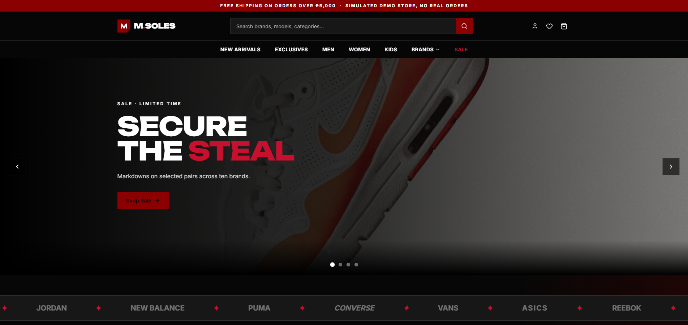
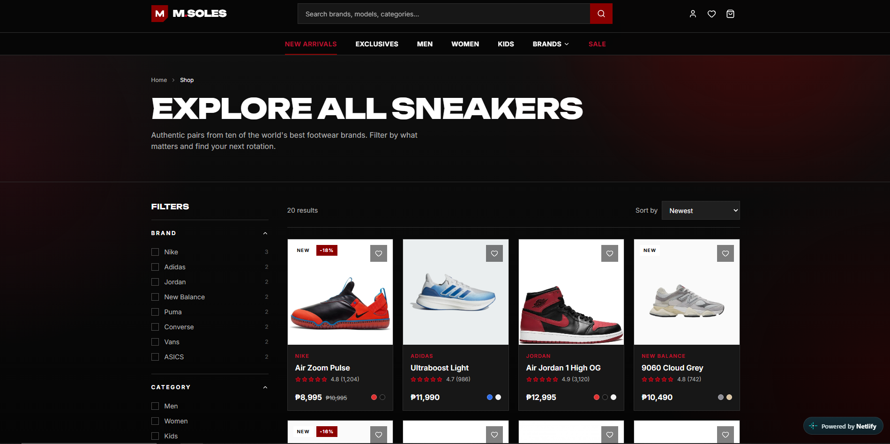

# M.Soles — Multi-Brand Sneaker Store

M.Soles is a full-stack sneaker e-commerce web application featuring a curated collection of sneakers from popular brands, including Nike, Adidas, Jordan, New Balance, Puma, Converse, Vans, ASICS, Reebok, and Under Armour.

Built with React and TypeScript, the platform provides a modern shopping experience where users can explore products, browse different colorways, manage their wishlist and shopping cart, and place orders. It also includes user authentication, database integration, product image management, and an administrative dashboard.

**Live Demo:** https://mdsoles.netlify.app/




## Features

- **Multi-Brand Sneaker Catalog** — Browse sneakers from popular footwear brands.
- **Product Search and Filtering** — Search for sneakers and filter the catalog.
- **Product Details** — View product descriptions, prices, available sizes, colorways, and images.
- **Colorway Selection** — Select available sneaker colors and view their corresponding product images.
- **Shopping Cart** — Add products, update quantities, and manage cart items.
- **Wishlist** — Save favorite sneakers for later.
- **User Authentication** — Register, sign in, sign out, and manage user accounts.
- **Persistent User Data** — Store cart items, wishlist entries, addresses, and orders in the database.
- **Checkout and Order Processing** — Place orders with server-side price and stock validation.
- **Order History** — View previously placed orders.
- **Profile Management** — Manage account information and shipping addresses.
- **Admin Dashboard** — Manage products, product images, and customer orders.
- **Role-Based Access Control** — Restrict administrative features to authorized users.
- **Product Image Management** — Upload and store product images.
- **Responsive Design** — Browse the store on different screen sizes.

## Built With

- **React** — Frontend library for building the user interface.
- **TypeScript** — Static typing for more maintainable code.
- **Vite** — Frontend development server and build tool.
- **Netlify Functions** — Server-side API and application logic.
- **Netlify Identity** — User authentication and account management.
- **Netlify Database / PostgreSQL** — Persistent application data storage.
- **Drizzle ORM** — Database schema and query management.
- **Netlify Blobs** — Product image storage.
- **CSS** — Styling, layouts, and responsive design.

## How It Works

### Customer Experience

1. Browse the sneaker catalog and explore different brands.
2. Search for products or use the available filters.
3. Open a product page to view its details, images, sizes, and colorways.
4. Add products to the shopping cart or wishlist.
5. Sign in or create an account to proceed with checkout.
6. Submit an order and view its details in the account's order history.

### Admin Experience

1. Sign in using an account assigned the administrator role.
2. Open the admin dashboard.
3. Add, edit, or manage sneaker products and their images.
4. View and manage customer orders.
5. Access administrative features protected by server-side role checks.

## Getting Started

### Prerequisites

Before running the project locally, make sure you have the following installed:

- [Node.js](https://nodejs.org/)
- npm (included with Node.js)
- [Git](https://git-scm.com/)
- [Netlify CLI](https://docs.netlify.com/cli/get-started/)
- A Netlify project with the required database and services configured

### Installation

**1. Clone the repository**

Replace the URL below with your GitHub repository URL.

```bash
git clone YOUR_GITHUB_REPOSITORY_URL
```

**2. Open the project folder**

```bash
cd YOUR_REPOSITORY_NAME
```

**3. Install dependencies**

```bash
npm install
```

**4. Log in to Netlify**

```bash
netlify login
```

**5. Link the local project to your Netlify site**

```bash
netlify link
```

**6. Configure the required Netlify services**

Make sure the linked Netlify project has its database and required services configured. Follow the project's environment and database setup before running the application.

**7. Run the project locally**

```bash
netlify dev
```

The local development URL will be displayed in your terminal after the development server starts.

> Note: Database migrations and deployment configuration may be required before all features work locally. Check the project's current Netlify and database configuration before running migrations.

## Project Structure

The project is organized into frontend components, application pages, shared context, service modules, serverless functions, and database files.

```text
M.Soles/
├── src/
│   ├── components/       # Reusable UI components
│   ├── pages/            # Application pages
│   ├── context/          # Shared application and authentication state
│   └── services/         # Frontend service and API modules
├── netlify/
│   └── functions/        # Server-side API functions
├── db/                   # Database schema and migrations
├── netlify.toml          # Netlify configuration
├── package.json          # Project dependencies and scripts
└── README.md
```

> The structure above is a general overview. Folder and file names may vary depending on the current repository version.

## Security and Data Management

- Authentication is handled through Netlify Identity.
- Administrative operations require an authorized administrator role.
- Important checkout validations are performed server-side.
- Product, cart, wishlist, address, and order data are stored in the database.
- Product images are stored using Netlify Blobs.

## Project Objective

M.Soles was developed as a full-stack web development project to demonstrate the implementation of an e-commerce platform. It brings together frontend development, backend API functionality, database management, authentication, image storage, and administrative tools in one application.

The goal is to provide a clean, accessible, and convenient online sneaker shopping experience through a modern interface.

## Author

**Marion Anthony S. Dingal**  
Computer Science Student

## Live Demo

Visit the deployed application:

https://mdsoles.netlify.app/

## Disclaimer

M.Soles is a student-developed project for educational and demonstration purposes. Product names and brand references belong to their respective owners. Product listings, prices, and availability may be sample data and are not necessarily affiliated with or endorsed by the brands mentioned.
